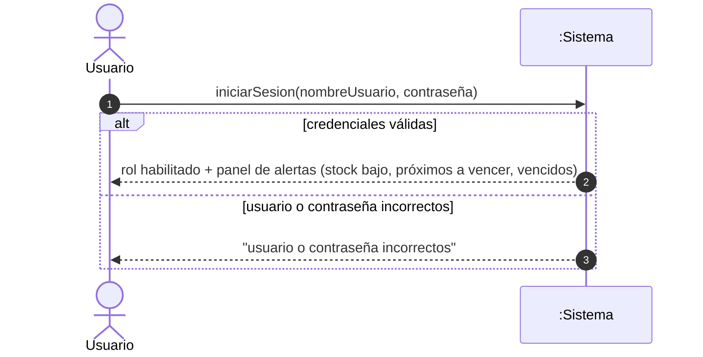
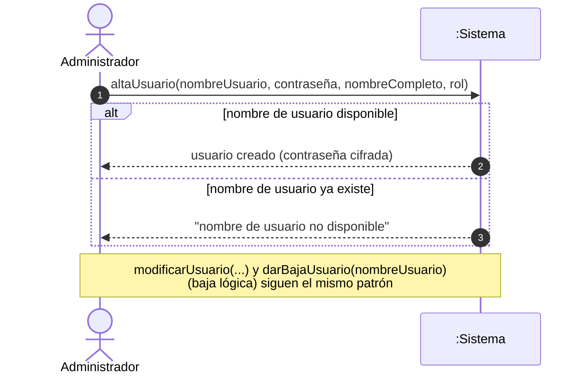
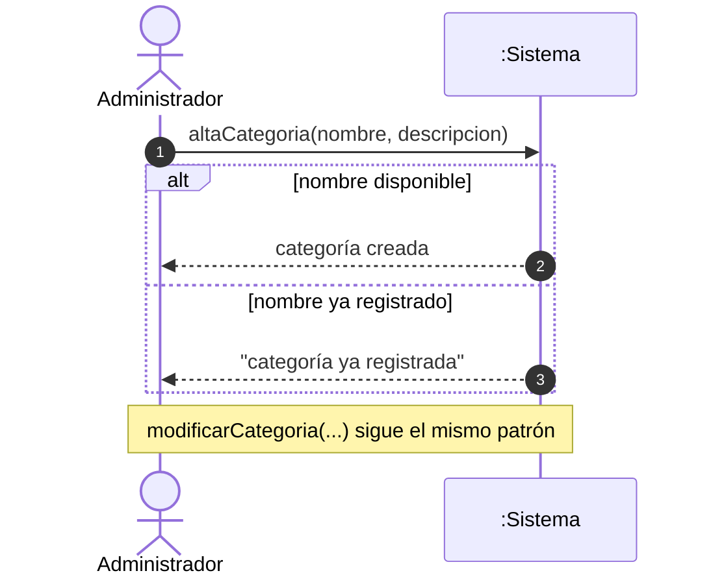
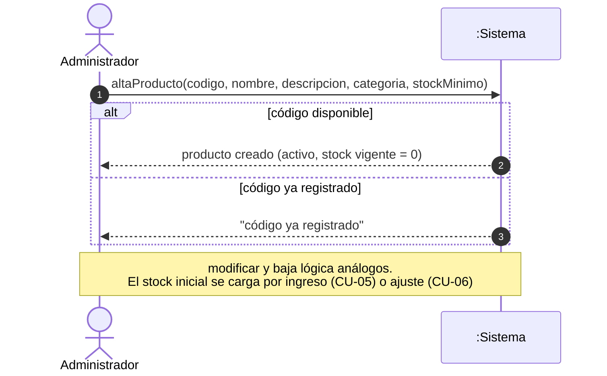
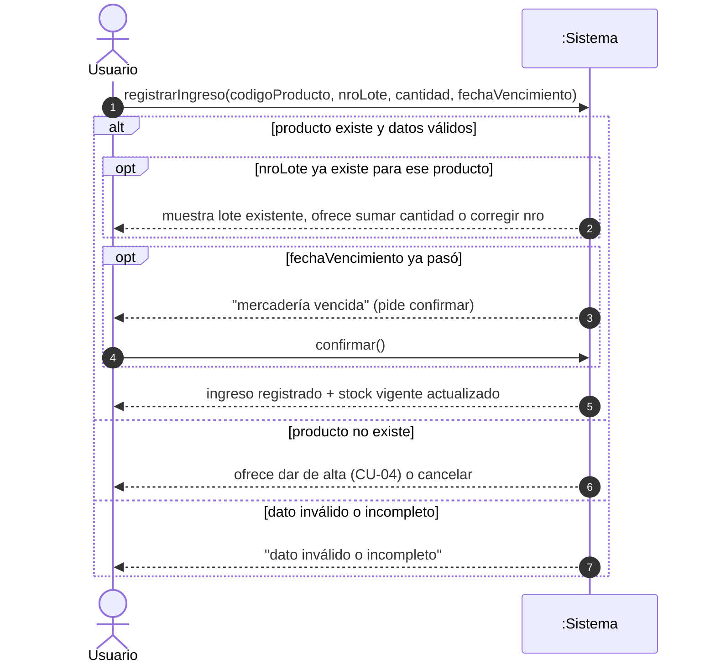
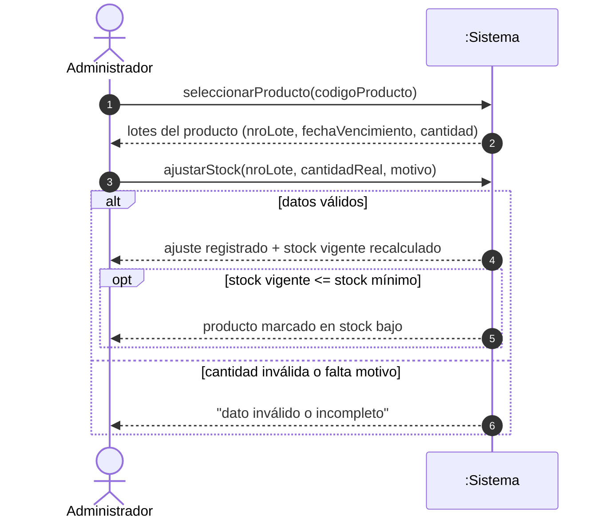
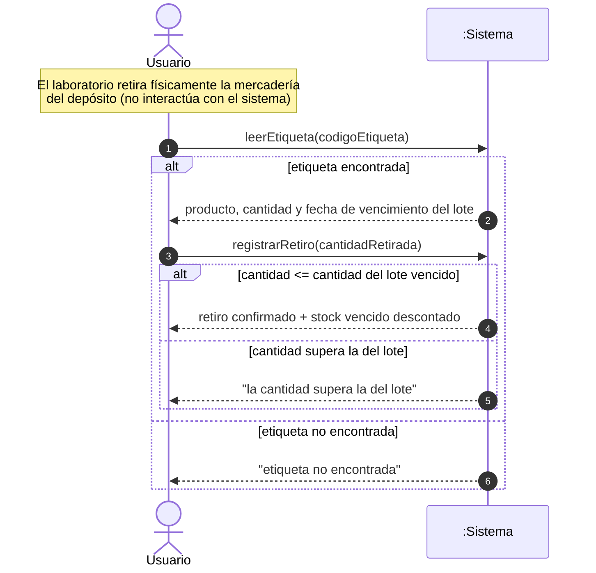
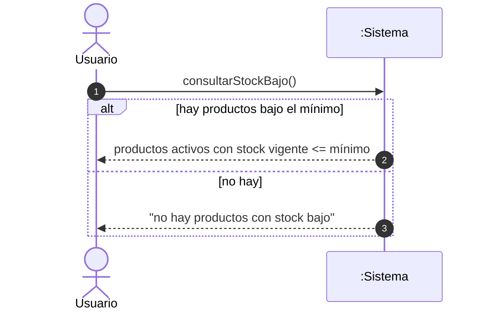
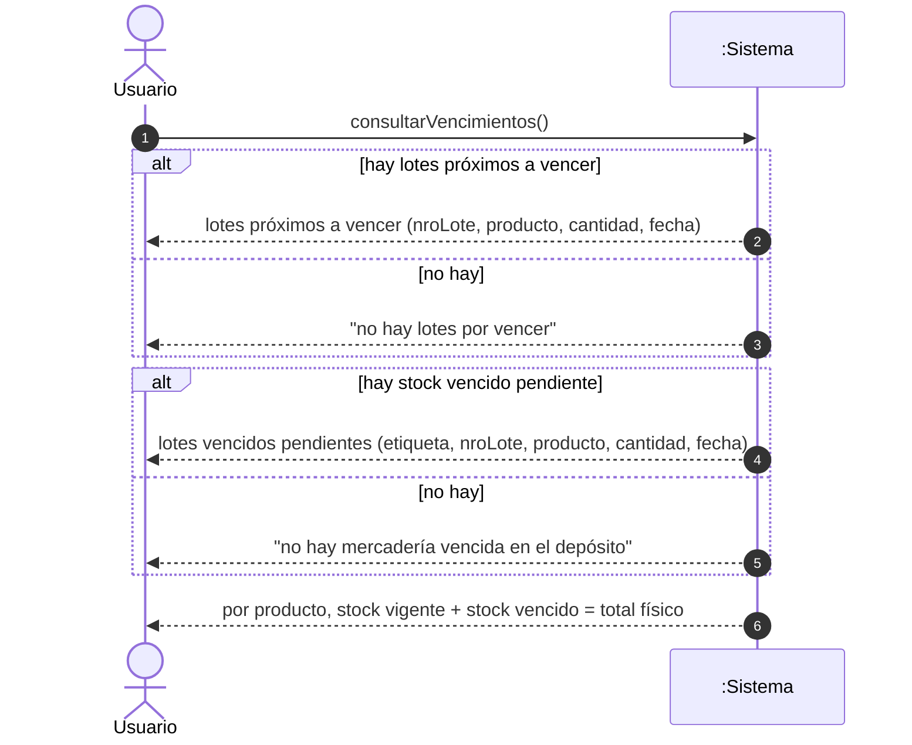

# Diagramas de Secuencia del Sistema (DSS) - Stock Proyect

> Nivel: DSS (sistema como caja negra). Los **procesos automáticos** (vencimiento de lote, alertas) no se incluyen porque no los inicia un actor.

---

## CU-01 - Iniciar sesión

---

## CU-02 - Gestionar usuario

---

## CU-03 - Gestionar categoría

---

## CU-04 - Gestionar producto

---

## CU-05 - Registrar ingreso de mercadería

---

## CU-06 - Ajustar stock

---

## CU-07 - Registrar retiro de mercadería vencida

---

## CU-08 - Consultar productos con stock bajo

---

## CU-09 - Consultar vencimientos y stock vencido

