# Diagramas de Secuencia de Diseño (DSD) - Stock Proyect

> **Nivel:** DSD. El `:Sistema` de caja negra se reemplaza por un **controlador** por caso de uso (patrón Controlador), que recibe la operación del actor y la delega hacia la derecha en los objetos del [Diagrama de Clases](../07-Diagrama%20De%20Clases/Diagrama_de_Clases.puml).
>
> **Convenciones** (igual que en la teoría):
> - Flecha llena: mensaje sincrónico, con sus parámetros tipados.
> - Flecha punteada: retorno, con el valor devuelto entre comillas latinas: `«valor : Tipo»`.
> - `crear(...)` / `registrar(...)`: operación de clase (`{static}`) que crea el objeto; el objeto nuevo aparece en el punto donde se crea.
> - `loop` = bucle, `opt` = opcional, `alt` = alternativo.
> - `responsable:Usuario` es el usuario logueado que ejecuta la operación; las operaciones lo verifican con `esAdministrador()` (RN-11).
> - **⚠** marca un método que el caso de uso necesita y que **todavía no existe en el DCC**.
>
> Los **procesos automáticos** (vencimiento de lote, alertas) no se diagraman porque no los inicia un actor.

---

## CU-01 - Iniciar sesión

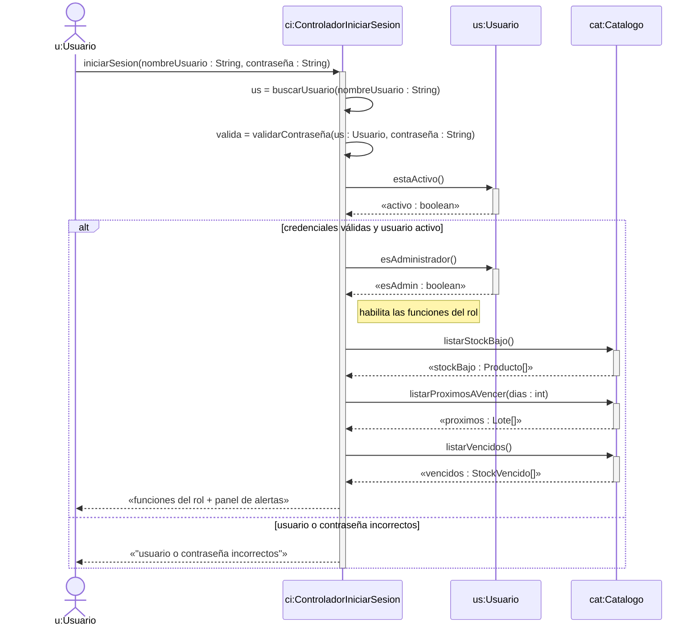

> La búsqueda del usuario y la validación de la contraseña son del controlador: según la nota del DCC, la autenticación la resuelve el control de acceso del sistema, no la entidad `Usuario`.

---

## CU-02 - Gestionar usuario

### Alta

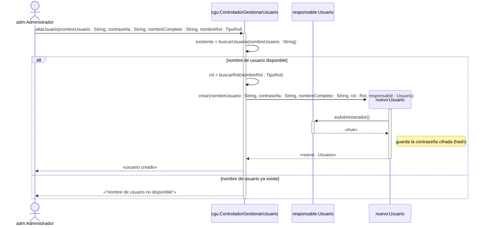

### Modificación y baja

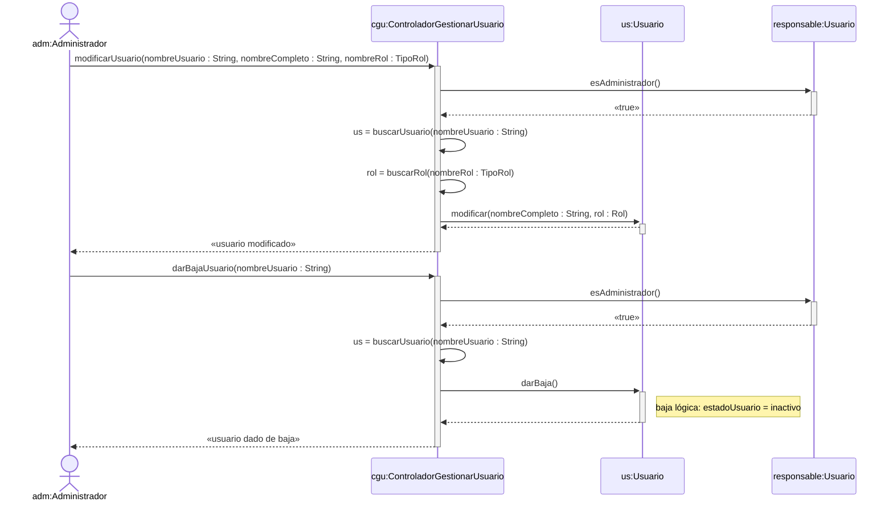

---

## CU-03 - Gestionar categoría

### Alta

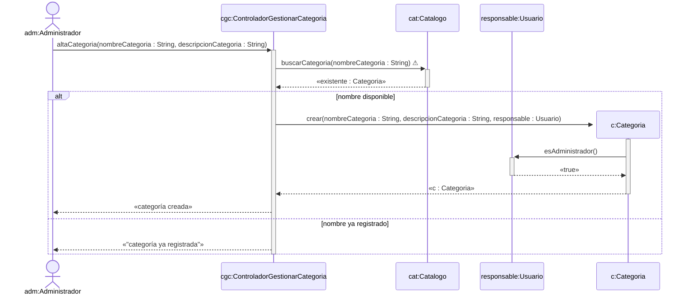

### Modificación

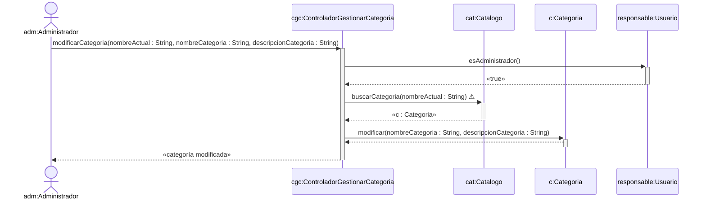

---

## CU-04 - Gestionar producto

### Alta

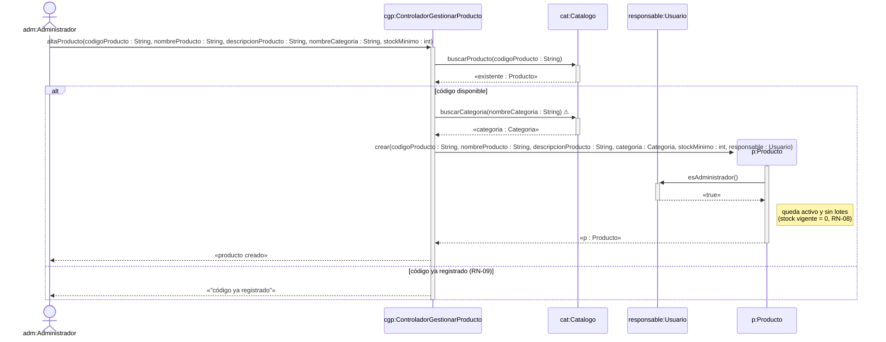

### Modificación y baja

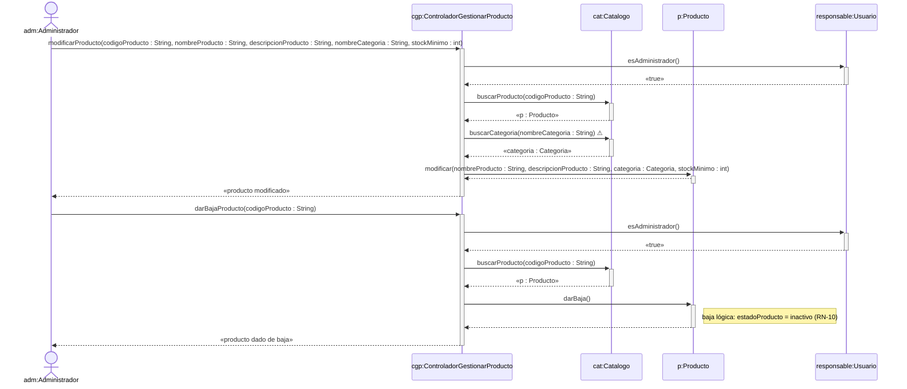

---

## CU-05 - Registrar ingreso de mercadería

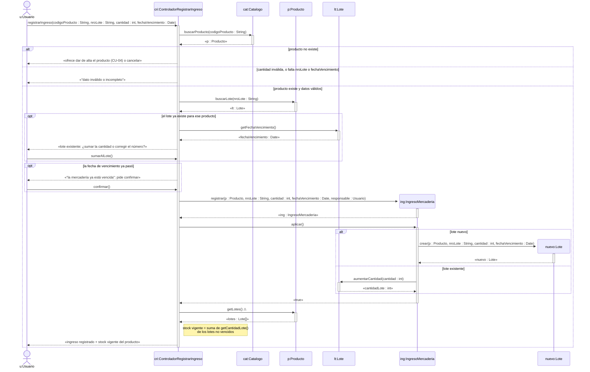

> El movimiento queda asentado con el usuario y la fecha (RN-07): `registrar(...)` recibe al `responsable`.

---

## CU-06 - Ajustar stock

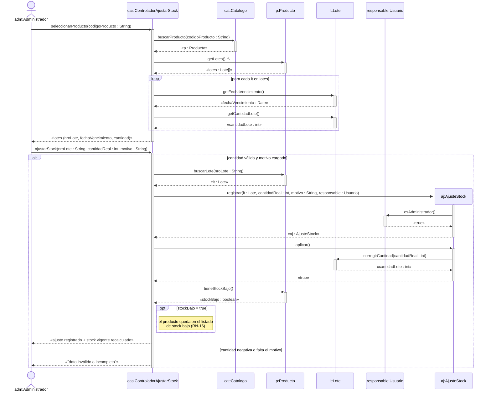

---

## CU-07 - Registrar retiro de mercadería vencida

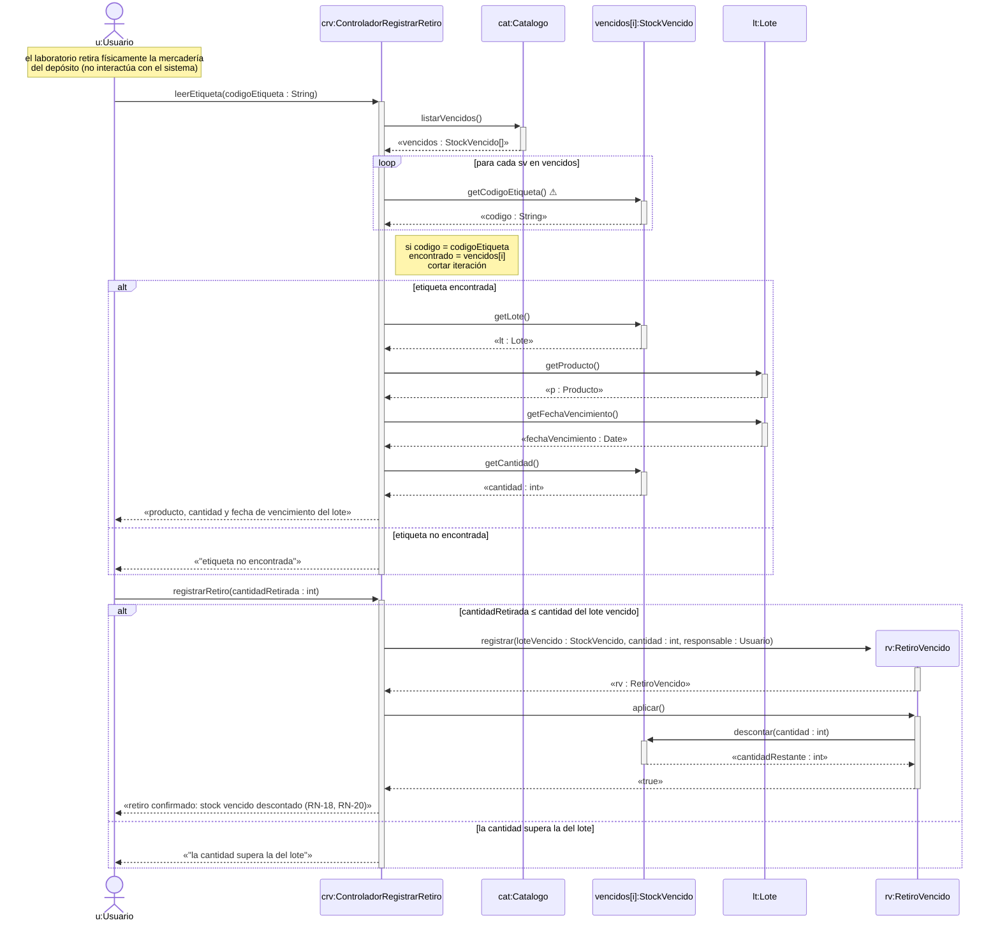

> Si el usuario cancela antes de confirmar (5.b del CU), no se envía `registrarRetiro` y no hay cambios.

---

## CU-08 - Consultar productos con stock bajo

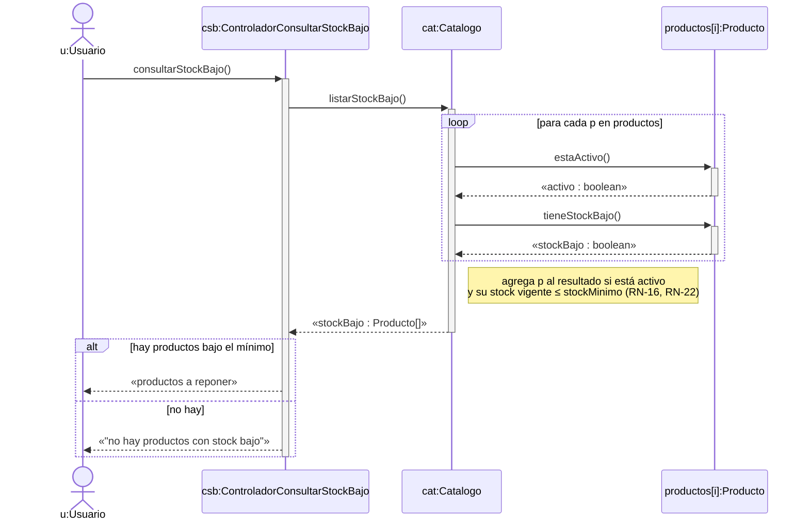

---

## CU-09 - Consultar vencimientos y stock vencido

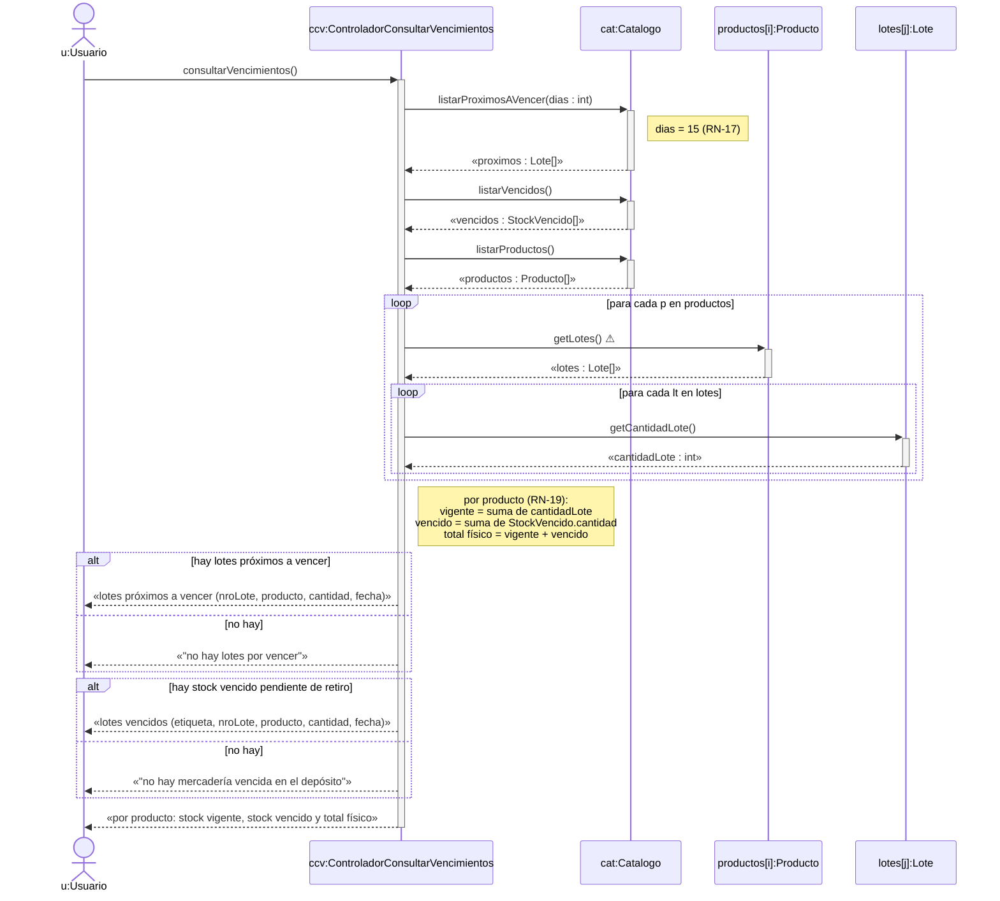

---

## Métodos que faltan en el DCC (⚠)

Los diagramas usan tres métodos que los casos de uso necesitan y el diagrama de clases todavía no tiene:

| Método | Lo usan | Para qué |
|---|---|---|
| `Catalogo.buscarCategoria(nombreCategoria : String) : Categoria` | CU-03, CU-04 | validar que el nombre no se repita y obtener la categoría del producto |
| `Producto.getLotes() : Lote[]` | CU-05, CU-06, CU-09 | listar los lotes de un producto y calcular su stock vigente |
| `StockVencido.getCodigoEtiqueta() : String` | CU-07 | encontrar el lote vencido por la etiqueta leída |

Los **controladores** (`ControladorIniciarSesion`, `ControladorGestionarUsuario`, etc.) son clases de diseño nuevas: no figuran en el DCC, que modela solo el dominio.
