# Diagramas de Secuencia de Diseño (DSD) - Stock Proyect

Diagramas hechos en **PlantUML** siguiendo los ejemplos de `crearNuevaVenta` e `introducirArticulo` de la teoría. Hay **un diagrama por operación del sistema**: cada uno se muestra como imagen y debajo tiene su código (desplegable *Código PlantUML*).

## Convenciones (las de la teoría)

- **Un DSD por operación del sistema**: empieza con un único mensaje del actor al controlador y termina con su retorno. Si una operación usa algo que obtuvo la anterior, el controlador lo conserva (como `ventaActual`).
- **Controlador** por caso de uso (`cpv:ControladorProcesarVenta` en la teoría): es el único que habla con el actor y delega hacia la derecha.
- Objetos como `nombre:Clase` **subrayados**, con líneas de vida punteadas. El actor es el rol (`adm:Administrador`).
- Flecha llena: mensaje con sus parámetros tipados. Flecha punteada: retorno `«valor : Tipo»` (sin texto si no devuelve nada).
- **Ninguna flecha sale y vuelve a la misma línea de vida**: los cálculos y comparaciones van en una nota, como `subtotal = subtotal + (cantidad * precio)`.
- **Búsquedas y listados**: el dueño de la colección (el Catálogo, como `cp:CatalogoDeProductos` en la teoría) la recorre en un marco `bucle [para cada ...]`, le pide a cada `coleccion[i]` el dato con su getter, y una nota dice qué hace: `si ... cortar iteración` en una búsqueda, `agregar al resultado` en un listado. El objeto encontrado es otra línea de vida, como `especif[i]` y `ep`.
- `crear(...)` / `registrar(...)`: flecha punteada de creación; la caja del objeto nuevo aparece a esa altura.
- Marcos `alt`, `opt` y `bucle` con su condición de guarda, según la tabla de operadores de la teoría.

Los **procesos automáticos** (vencimiento de lote, alertas) no se diagraman porque no los inicia un actor. Los **controladores** son clases de diseño y no figuran en el [Diagrama de Clases](../07-Diagrama%20De%20Clases/Diagrama_de_Clases.puml), que modela solo el dominio; todos los métodos que los DSD invocan sobre objetos del dominio existen en el DCC.

## Índice

- **CU-01 - Iniciar sesión**: `iniciarSesion`
- **CU-02 - Gestionar usuario**: `altaUsuario`, `modificarUsuario`, `darBajaUsuario`
- **CU-03 - Gestionar categoría**: `altaCategoria`, `modificarCategoria`
- **CU-04 - Gestionar producto**: `altaProducto`, `modificarProducto`, `darBajaProducto`
- **CU-05 - Registrar ingreso de mercadería**: `registrarIngreso`, `confirmarIngreso`
- **CU-06 - Ajustar stock**: `seleccionarProducto`, `ajustarStock`
- **CU-07 - Registrar retiro de mercadería vencida**: `leerEtiqueta`, `registrarRetiro`
- **CU-08 - Consultar productos con stock bajo**: `consultarStockBajo`
- **CU-09 - Consultar vencimientos y stock vencido**: `consultarVencimientos`

---

## CU-01 - Iniciar sesión

Código PlantUML

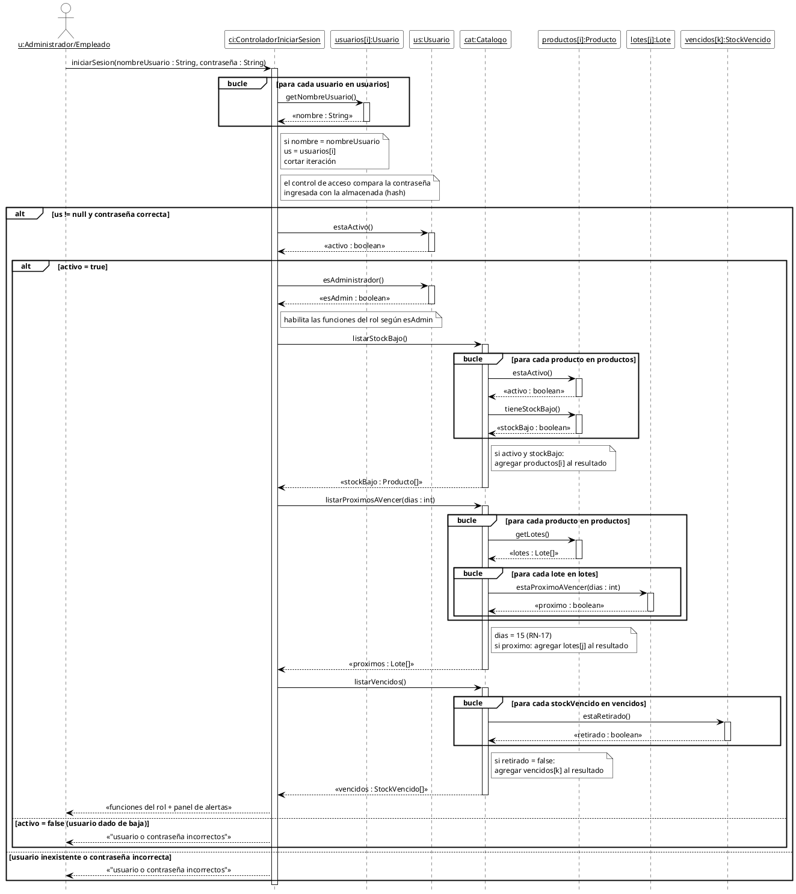

---

## CU-02 - Gestionar usuario

### `altaUsuario`

Código PlantUML

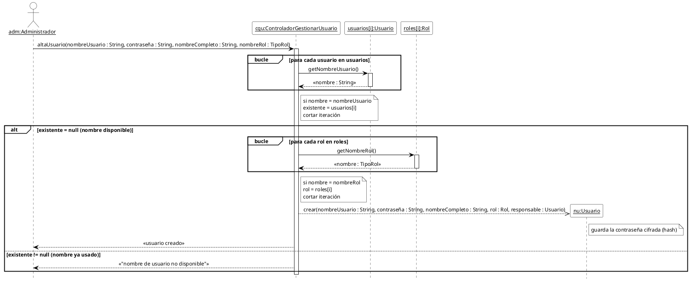

### `modificarUsuario`

Código PlantUML

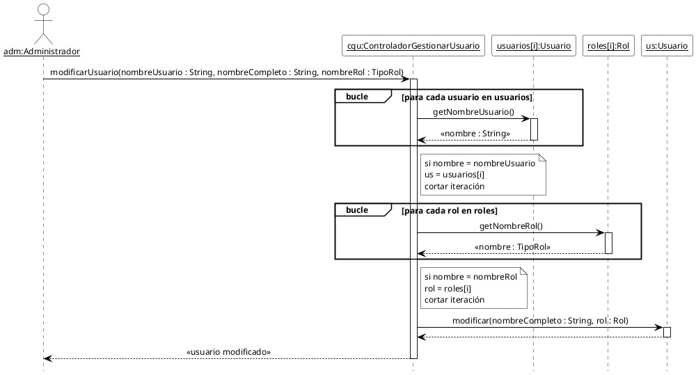

### `darBajaUsuario`

Código PlantUML

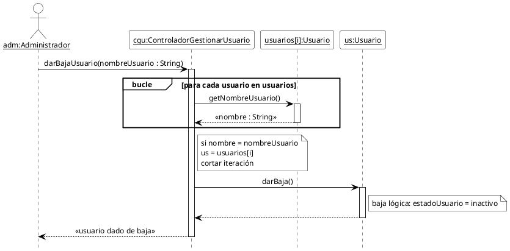

---

## CU-03 - Gestionar categoría

### `altaCategoria`

Código PlantUML

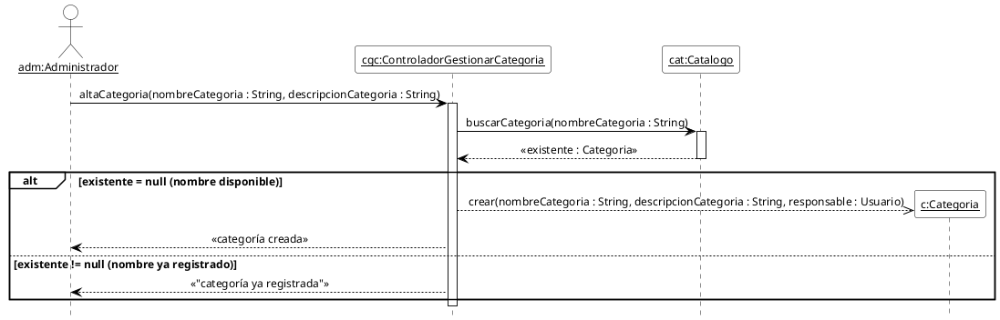

### `modificarCategoria`

Código PlantUML

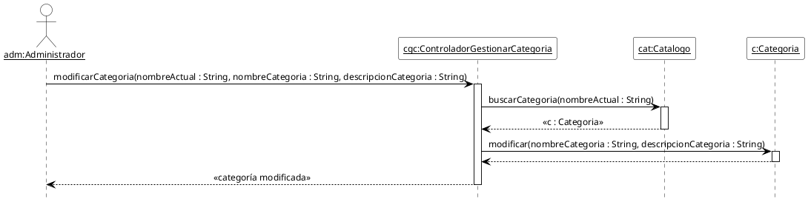

---

## CU-04 - Gestionar producto

### `altaProducto`

Código PlantUML

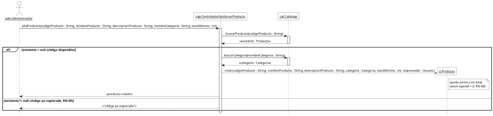

### `modificarProducto`

Código PlantUML

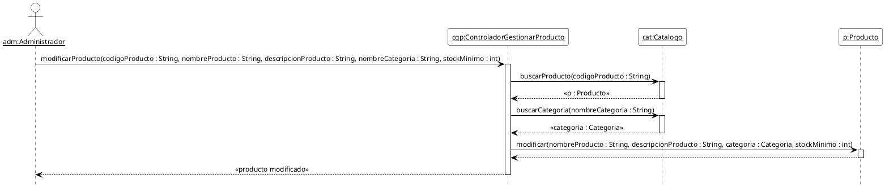

### `darBajaProducto`

Código PlantUML

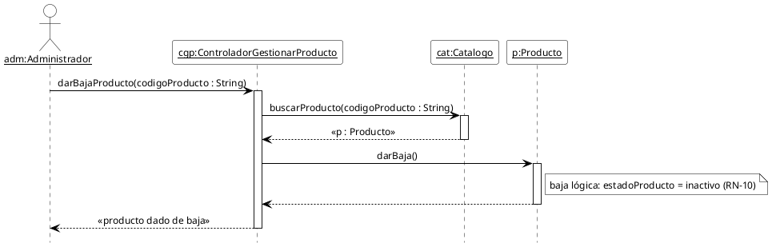

---

## CU-05 - Registrar ingreso de mercadería

### `registrarIngreso`

El usuario hace dos operaciones: primero carga los datos y el sistema le muestra qué va a pasar (lote nuevo o existente, y si la mercadería ya está vencida); después confirma con `confirmarIngreso`. Si quiere corregir el número de lote (3.b del CU), vuelve a enviar `registrarIngreso`.

Código PlantUML

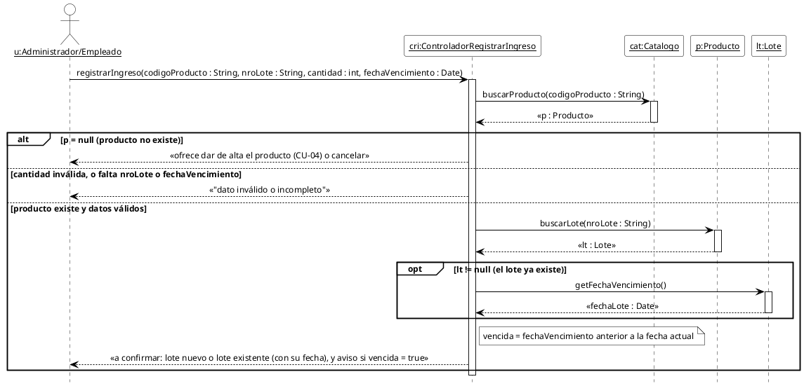

### `confirmarIngreso`

Código PlantUML

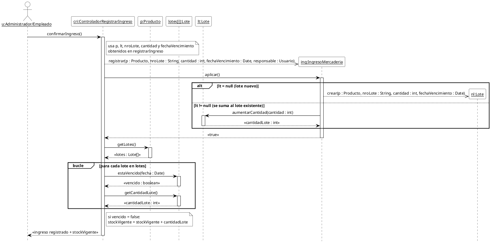

> El movimiento queda asentado con el usuario y la fecha (RN-07): `registrar(...)` recibe al `responsable`.

---

## CU-06 - Ajustar stock

### `seleccionarProducto`

Código PlantUML

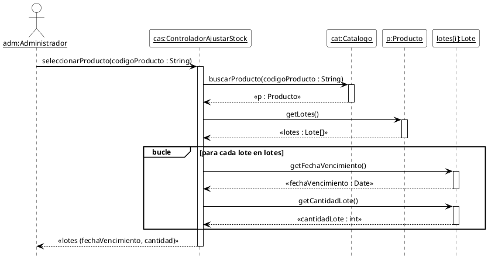

### `ajustarStock`

Código PlantUML

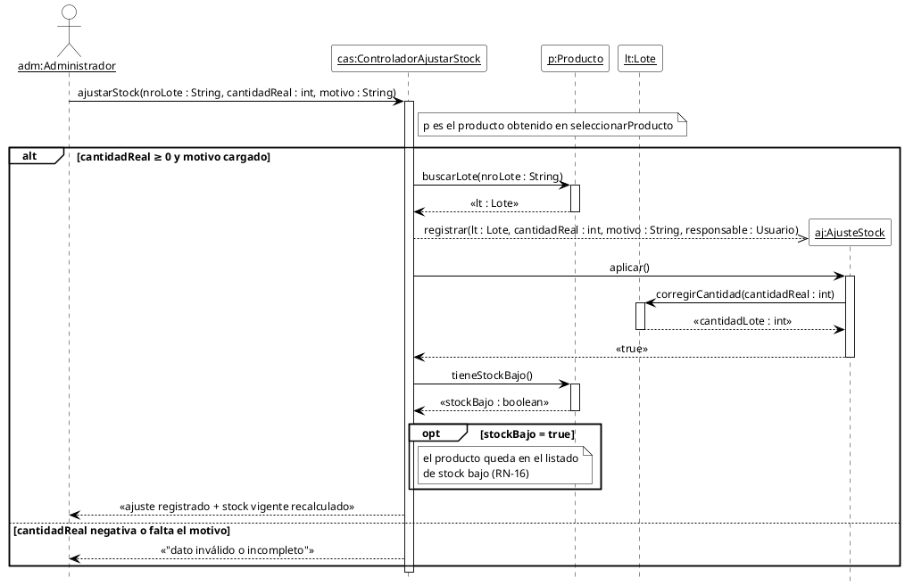

---

## CU-07 - Registrar retiro de mercadería vencida

### `leerEtiqueta`

Código PlantUML

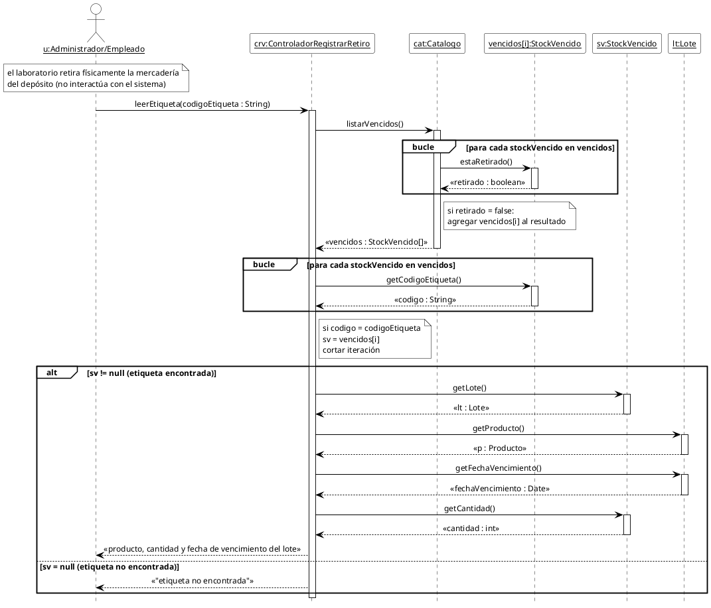

### `registrarRetiro`

Código PlantUML

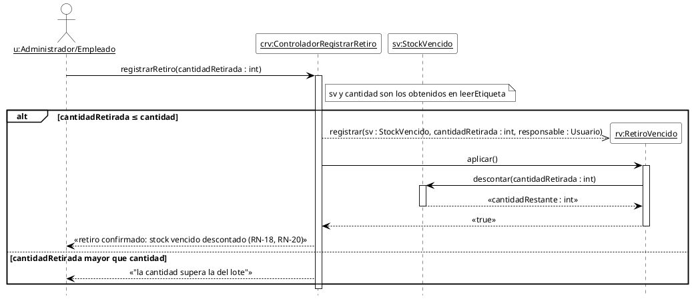

> Si el usuario cancela antes de confirmar (5.b del CU), no se envía `registrarRetiro` y no hay cambios.

---

## CU-08 - Consultar productos con stock bajo

Código PlantUML

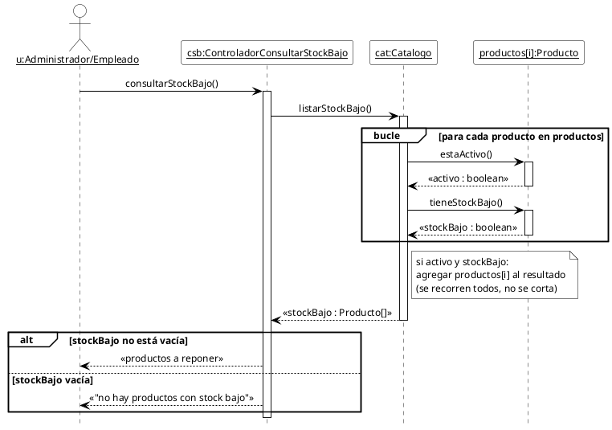

---

## CU-09 - Consultar vencimientos y stock vencido

Código PlantUML

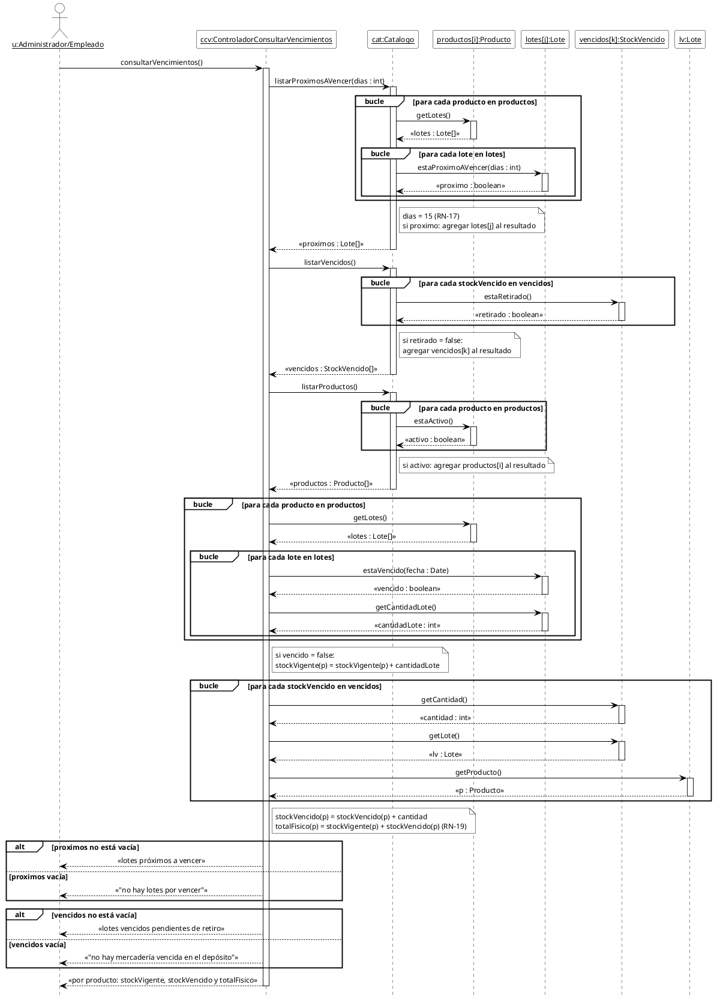

