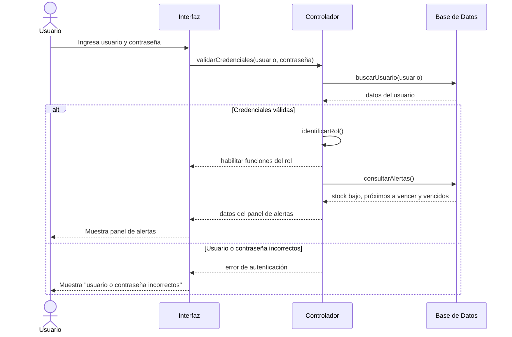
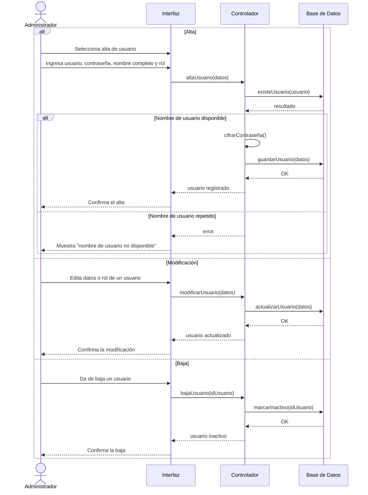
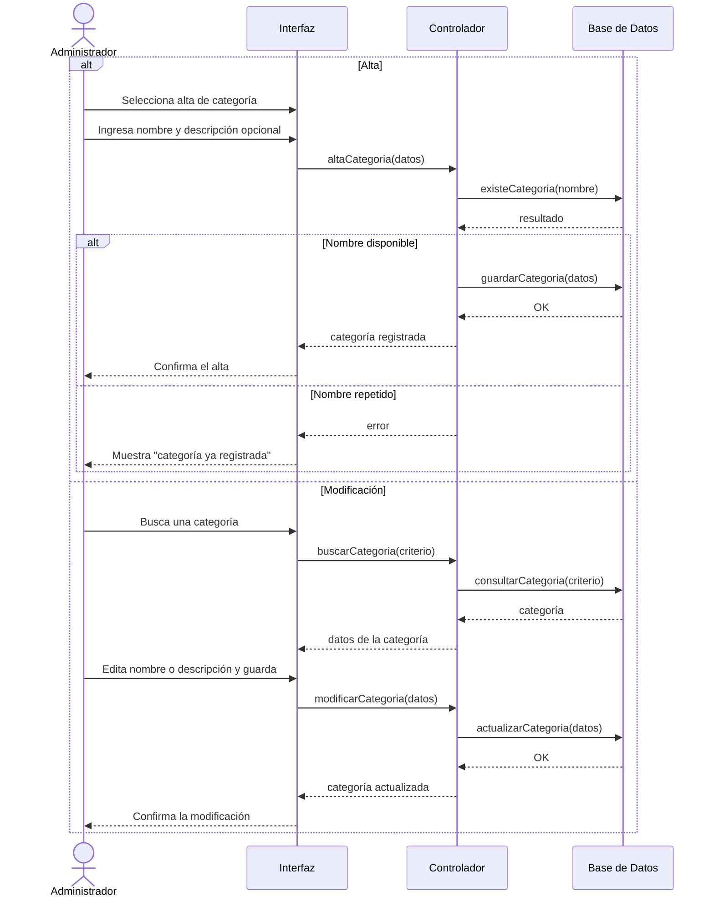
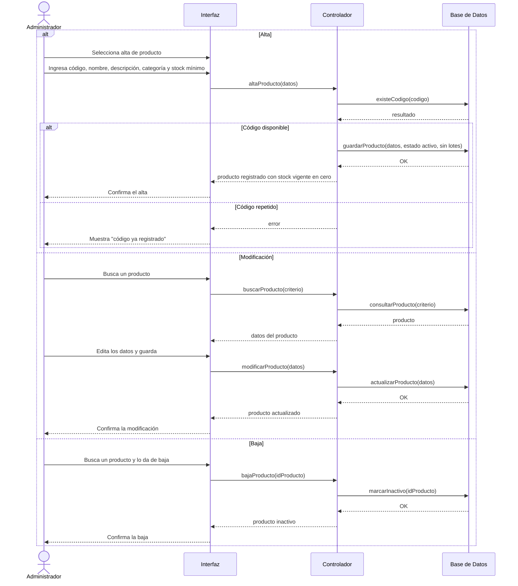
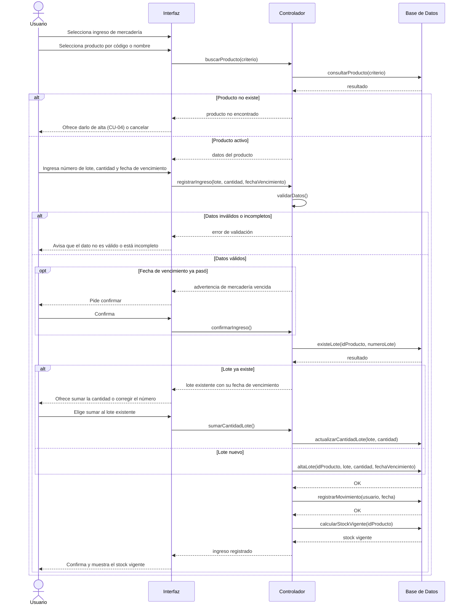
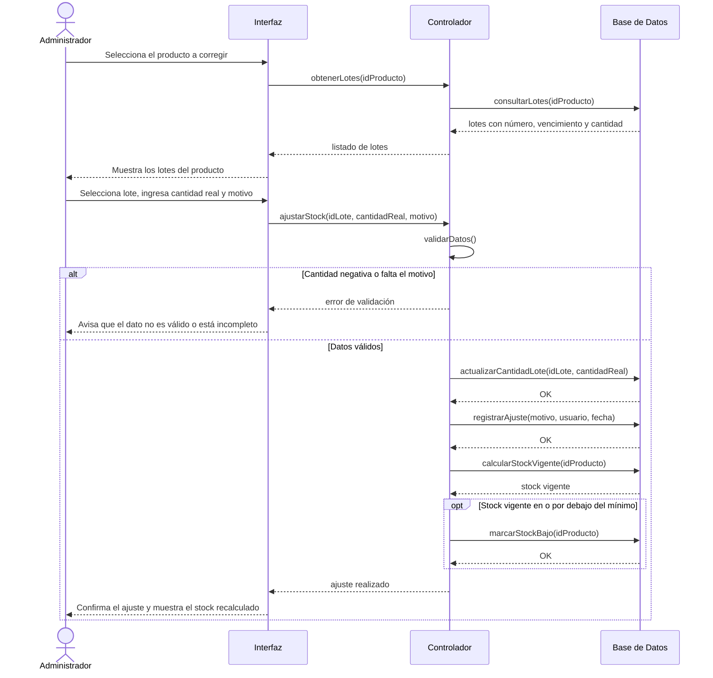
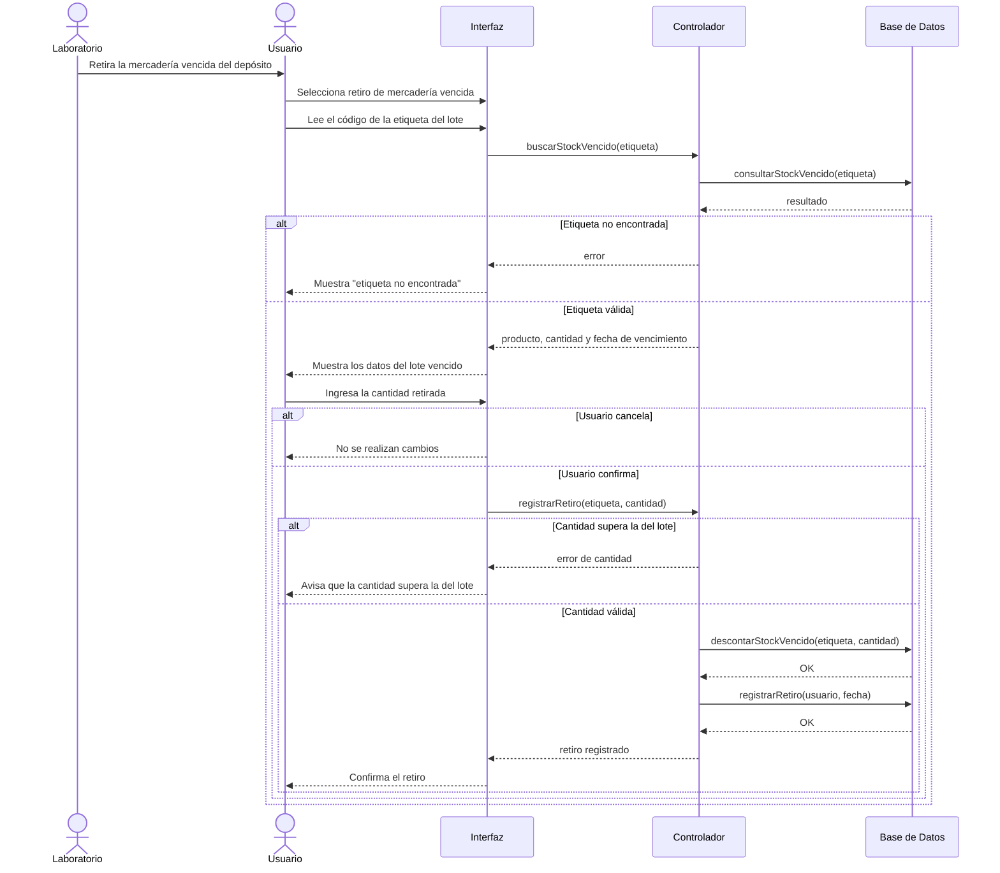
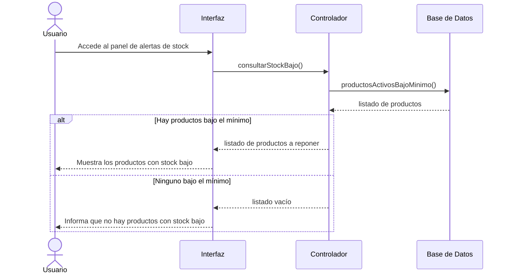
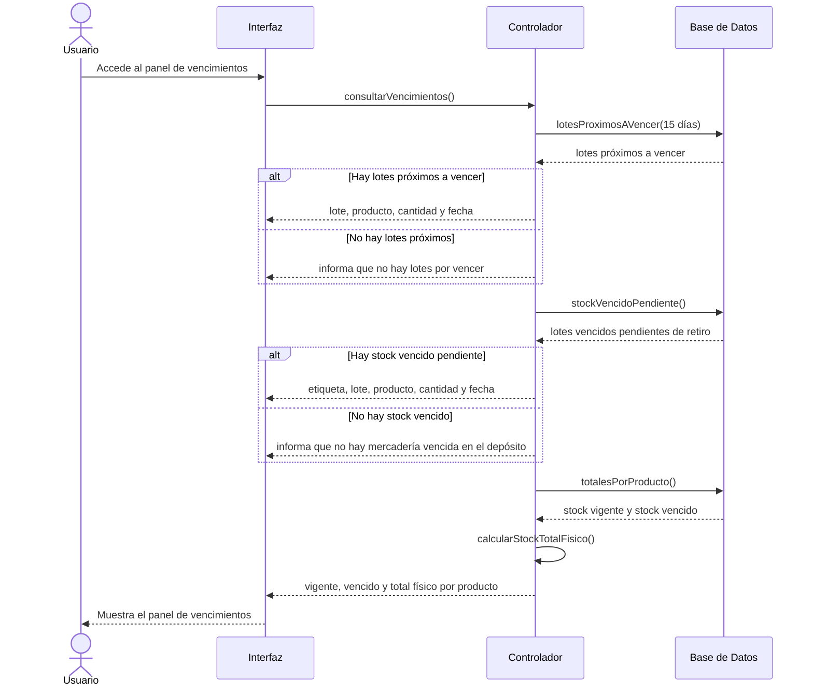

# Diagramas de Secuencia - Stock Proyect

Un diagrama por caso de uso. Cada bloque se pega por separado en Mermaid (mermaid.live).
Participantes: actor, Interfaz (pantalla), Controlador (lógica del sistema) y Base de Datos.

---

## CU-01 - Iniciar sesión

---

## CU-02 - Gestionar usuario (alta, baja y modificación)

---

## CU-03 - Gestionar categoría (alta y modificación)

---

## CU-04 - Gestionar producto (alta, baja y modificación)

---

## CU-05 - Registrar ingreso de mercadería

---

## CU-06 - Ajustar stock

---

## CU-07 - Registrar retiro de mercadería vencida

---

## CU-08 - Consultar productos con stock bajo

---

## CU-09 - Consultar vencimientos y stock vencido

