# Diagramas de Secuencia de Diseño (DSD) - Stock Proyect

> **Nivel:** DSD. El `:Sistema` de caja negra se reemplaza por un **controlador** por caso de uso (patrón Controlador), que recibe la operación del actor y la delega hacia la derecha en los objetos del [Diagrama de Clases](../07-Diagrama%20De%20Clases/Diagrama_de_Clases.puml).
>
> **Convenciones** (las mismas de los ejemplos de `introducirArticulo` de la teoría):
> - Flecha llena: mensaje sincrónico, con sus parámetros tipados.
> - Flecha punteada: retorno, con el valor devuelto entre comillas latinas: `«valor : Tipo»`. Un retorno sin texto indica que el método no devuelve nada.
> - **No hay mensajes de un objeto a sí mismo.** Los cálculos y comparaciones se escriben en una nota (como `subtotal = subtotal + (cantidad * precio)` en la teoría).
> - **Las búsquedas y los listados se dibujan recorriendo la colección** en un `loop` (bucle): a cada elemento `coleccion[i]` se le pide el dato con su getter, y una nota dice qué se hace (`si ... cortar iteración` en una búsqueda, `agregar al resultado` en un listado). El objeto encontrado es otra línea de vida, como `especif[i]` y `ep` en la teoría.
> - `buscarProducto`, `buscarCategoria`, `buscarLote` y `listarVencidos` son operaciones del Catálogo y del Producto en el DCC: se muestran como un mensaje con su retorno, porque el DCC no tiene los getters ni las asociaciones para dibujar su recorrido.
> - Flecha punteada con punta abierta `crear(...)` / `registrar(...)`: creación; la caja del objeto nuevo aparece a esa altura.
> - `loop` = bucle, `opt` = opcional, `alt` = alternativo.
> - `responsable:Usuario` es el usuario logueado; donde la operación es exclusiva del Administrador, el controlador lo verifica con `esAdministrador()` (RN-11).
>
> Los **procesos automáticos** (vencimiento de lote, alertas) no se diagraman porque no los inicia un actor.

---

## CU-01 - Iniciar sesión

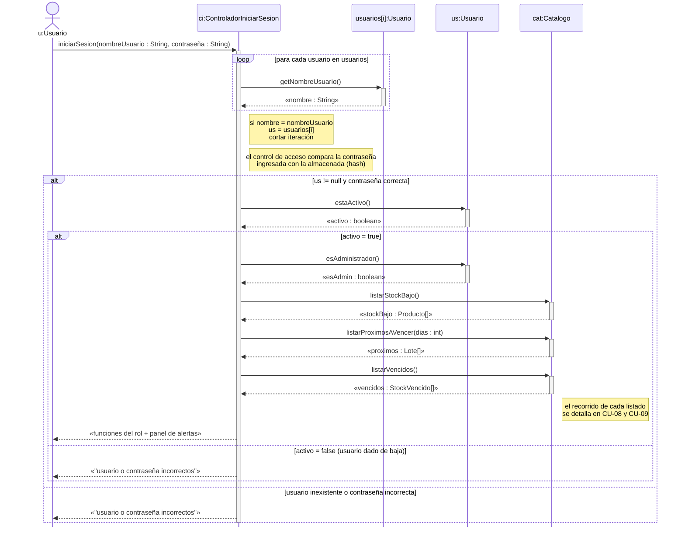

---

## CU-02 - Gestionar usuario

### Alta

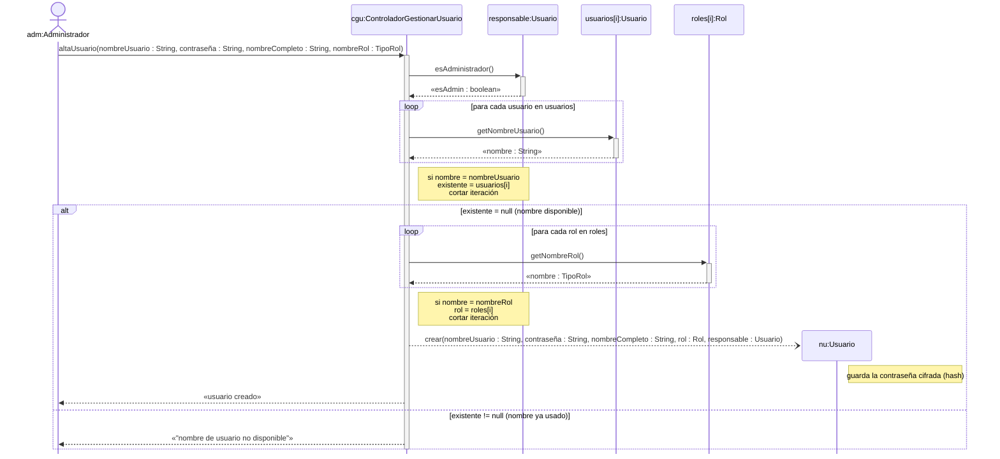

### Modificación y baja

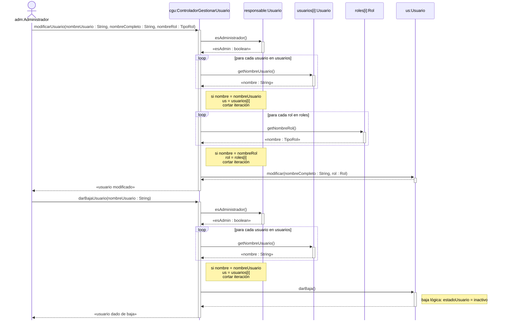

---

## CU-03 - Gestionar categoría

### Alta

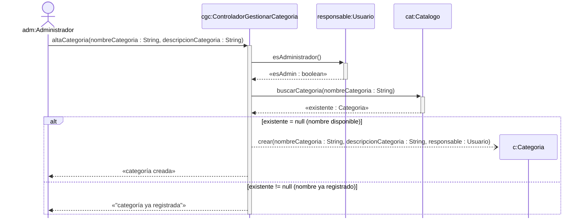

### Modificación

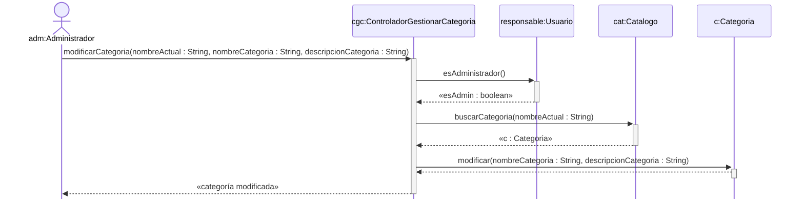

---

## CU-04 - Gestionar producto

### Alta

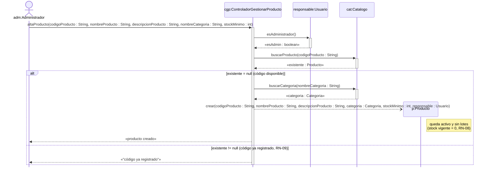

### Modificación y baja

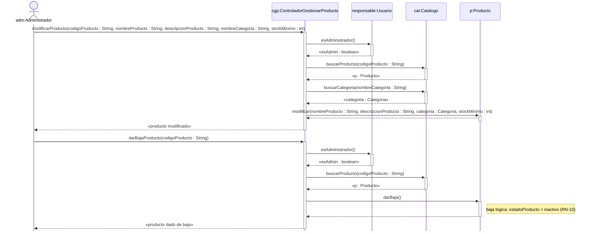

---

## CU-05 - Registrar ingreso de mercadería

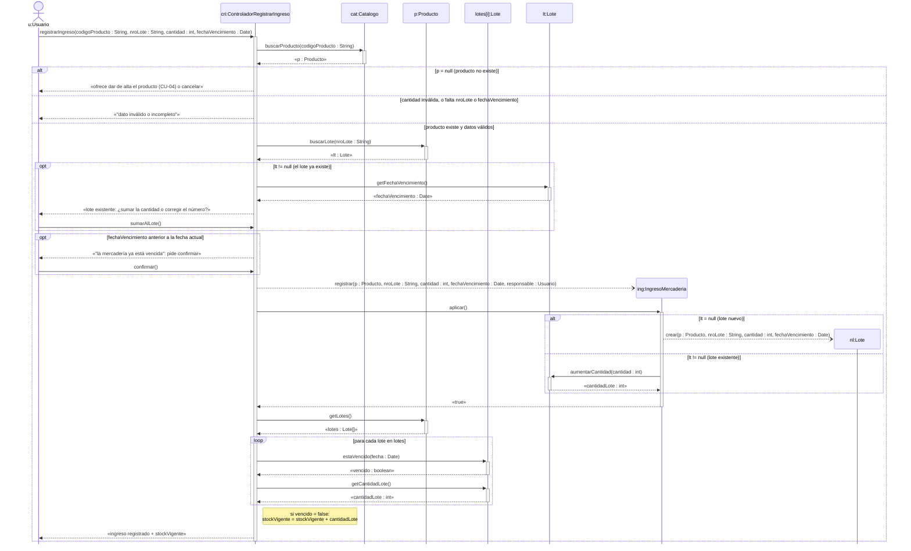

> El movimiento queda asentado con el usuario y la fecha (RN-07): `registrar(...)` recibe al `responsable`.

---

## CU-06 - Ajustar stock

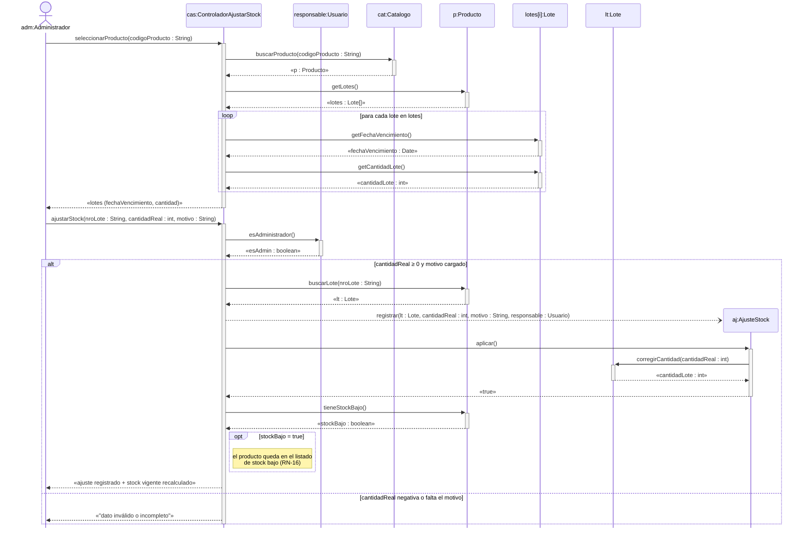

---

## CU-07 - Registrar retiro de mercadería vencida

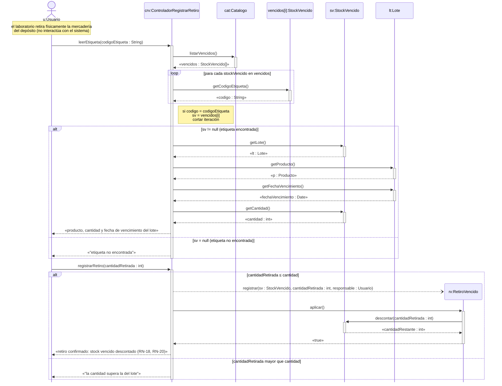

> Si el usuario cancela antes de confirmar (5.b del CU), no se envía `registrarRetiro` y no hay cambios.

---

## CU-08 - Consultar productos con stock bajo

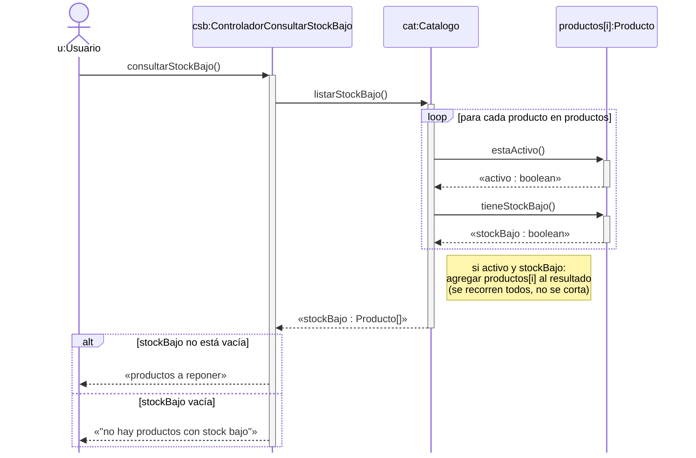

---

## CU-09 - Consultar vencimientos y stock vencido

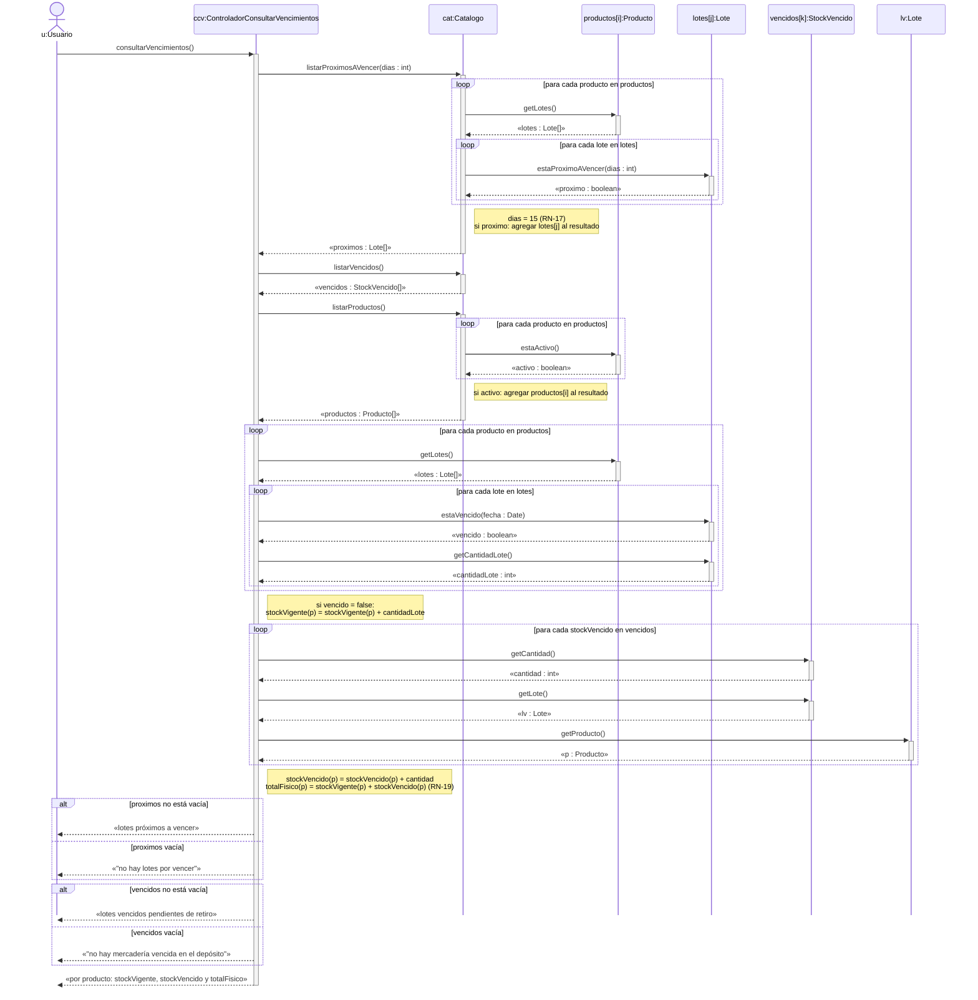

---

## Controladores

Los **controladores** (`ControladorIniciarSesion`, `ControladorGestionarUsuario`, etc.) son clases de diseño: no figuran en el DCC, que modela solo el dominio. Todos los métodos que los diagramas invocan sobre objetos del dominio existen en el [Diagrama de Clases](../07-Diagrama%20De%20Clases/Diagrama_de_Clases.puml).
